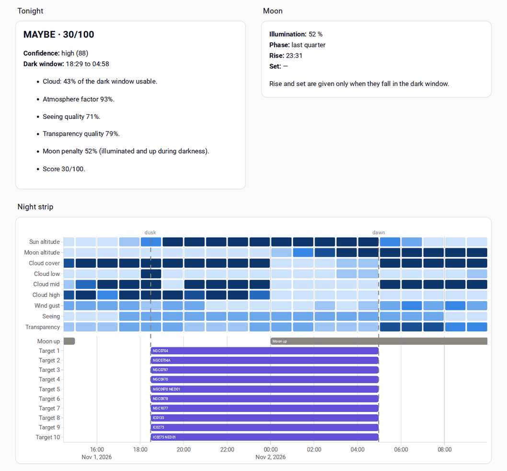

# The night dashboard: tonight at a glance in Home Assistant

This page gives you a complete Home Assistant dashboard for one pier. It shows
tonight's verdict, the moon, the ranked targets and the health of the weather
sources. In the middle is the night strip: the hours across, one row per
condition, with dusk, dawn, the moon and your targets on the same time line.

The dashboard reads only the entities PierPressure already publishes. You paste
it in once, and it updates itself.



## What the dashboard shows

| Card | What it shows | Where it comes from |
|---|---|---|
| **Tonight** | The verdict, the score, the confidence band and value, the dark window, and the reasons | The **Verdict** sensor's attributes |
| **Moon** | Illumination, phase, and moonrise and moonset when they fall in the dark window | The Verdict's `moon` attribute |
| **Night strip** | One row per condition, hour by hour, then a **Moon up** lane and one lane per ranked target | The nine timeline sensors' `forecast` attributes, the Verdict's `dark_window`, and **Target 1** to **Target 10** |
| **Targets** | Target 1 to Target 10 | The rank sensors. A rank with no target tonight shows as unavailable. |
| **Weather sources** | When Open-Meteo and 7Timer! last succeeded | The two health sensors |

### How to read the night strip

The strip runs from 4 hours before dusk to 5 hours after dawn. Times are in
your Home Assistant time zone. On a night with no astronomical darkness, it runs
from 6 hours before now to 18 hours after.

Each cell is one hour, drawn as a rounded block with a small gap to the next.
Darker means more of what the row names:

| Row | Lightest | Darkest |
|---|---|---|
| Sun altitude | Sun above the horizon | Astronomical night (sun below −18°). The steps between follow civil, nautical and astronomical twilight. |
| Moon altitude | Moon below the horizon | Moon high. One step darker for every 6° of altitude. |
| Cloud cover, Cloud low, Cloud mid, Cloud high | Clear | Overcast |
| Wind gust | Calm | Gusts of 42 km/h or more |
| Seeing, Transparency | Excellent | Poor. For these two rows, darker means worse. |

A blank space in a row means the weather source has no value for that hour.
Hover over a cell to see its value.

Under the rows, the **Moon up** lane has a bar for each stretch of hours when the
moon is above the horizon. Each target lane has a bar from the start to the end
of that target's observable window, labelled with its name. A rank with no
target tonight leaves no lane.

Dashed lines mark dusk and dawn, the two ends of the dark window. A red line
marks now. It follows your browser's clock and moves every 5 minutes.

## Before you start

You need:

- Home Assistant with PierPressure's entities in it. See the
  [README](../README.md#-home-assistant-entities).
- [HACS](https://hacs.xyz), the Home Assistant Community Store.

Install Plotly Graph Card through HACS before you paste the dashboard. The night
strip needs it, and the other cards are built into Home Assistant.

1. In Home Assistant, open **HACS**.
2. Search for **Plotly Graph Card** and open it.
3. Select **Download**, then confirm.
4. Reload the browser page when HACS asks you to.

## Add the dashboard

1. Go to **Settings** > **Dashboards** and select **Add dashboard**.
2. Choose **New dashboard from scratch**, give it a name such as `Night`, and
   select **Create**.
3. Open the new dashboard. Select the pencil to edit it, then the three-dot menu
   > **Raw configuration editor**.
4. Delete what is there and paste the YAML below.
5. Replace `backyard` with your pier's id everywhere it appears. The YAML uses it
   only in entity ids such as `sensor.pierpressure_backyard_verdict`, so a find
   and replace of `pierpressure_backyard_` works. Your pier's id is the `id` in
   PierPressure's `piers` setting, written the way Home Assistant writes it in an
   entity id: in lower case, with each run of other characters as one `_`. A
   pier with the id `Back-Yard` has `sensor.pierpressure_back_yard_verdict`. To
   be sure, find your **Verdict** sensor under **Settings** > **Entities** and
   copy the part between `pierpressure_` and `_verdict`.
6. Select **Save**, then close the editor.

## If something looks wrong

- **The strip shows "Custom element doesn't exist: plotly-graph".** Plotly
  Graph Card is not installed, or the browser has not loaded it yet. Install it
  as above, then reload the page.
- **The strip is empty and the cards say PierPressure is unavailable.**
  PierPressure is offline. The dashboard fills in again when it comes back.
- **The strip is empty but PierPressure is running.** Check that you replaced
  every `backyard`, and that you used your pier's id as it appears in your
  entity ids, as step 5 says.

Excluding the timeline sensors from the recorder, as
[the night timeline page](night-timeline.md#keep-the-forecast-out-of-the-recorder)
suggests, does not affect the dashboard. It reads the live attributes, not their
history.

## Versions it was checked with

The YAML below was checked with a running PierPressure in Home Assistant
2026.10.4, using Plotly Graph Card v4.0.2. The screenshot comes from that
check. A later release of either may change how the strip looks.

To repeat the check after changing the YAML, run `mise run dashboard-check` from
a clone of this repository. It starts a throwaway Home Assistant in Docker, with
its own MQTT broker and PierPressure, and loads the YAML from this page. It
never touches your own Home Assistant.

## The dashboard YAML

```yaml
title: PierPressure
views:
  - title: Tonight
    path: tonight
    type: sections
    max_columns: 4
    sections:
      - type: grid
        cards:
          - type: heading
            heading: Tonight
          - type: markdown
            content: |
              
              
              
              
              
              
              ## {{ verdict }} · {{ score }}/100

              **Confidence:** {{ confidence.band | lower }} ({{ confidence.value }})
              **Dark window:** {{ (dark.start | as_datetime | as_local).strftime('%H:%M') }} to {{ (dark.end | as_datetime | as_local).strftime('%H:%M') }}no astronomical night

              
              - {{ reason }}
              
              
              PierPressure is unavailable.
              
      - type: grid
        cards:
          - type: heading
            heading: Moon
          - type: markdown
            content: |
              
              
              **Illumination:** {{ (moon.illumination * 100) | round | int }} %
              **Phase:** {{ moon.phase }}
              **Rise:** {{ (moon.rise | as_datetime | as_local).strftime('%H:%M') if moon.rise else '—' }}
              **Set:** {{ (moon.set | as_datetime | as_local).strftime('%H:%M') if moon.set else '—' }}

              Rise and set are given only when they fall in the dark window.
              
              PierPressure is unavailable.
              
      - type: grid
        column_span: 4
        cards:
          - type: heading
            heading: Night strip
          - type: custom:plotly-graph
            grid_options:
              columns: full
            refresh_interval: 300
            time_zone: server
            pier_timeline: |
              $ex {
                // The seven blues, lightest to darkest, that bands 0 to 6 are drawn in.
                const blues = ["#cde2fb", "#9ec5f4", "#6da7ec", "#3987e5", "#256abf", "#184f95", "#0d366b"];
                const ramp = (v, step) => Math.min(6, Math.floor(v / step));
                const quality = (q) => Math.min(6, Math.round((1 - q) * 7));
                // Top to bottom: row label, timeline sensor, unit, and the band 0 (lightest) to 6 (darkest).
                const rows = [
                  ["Sun altitude", "sensor.pierpressure_backyard_sun_altitude", "°",
                    (v) => (v > 0 ? 0 : v > -6 ? 1 : v > -12 ? 2 : v > -18 ? 3 : 6)],
                  ["Moon altitude", "sensor.pierpressure_backyard_moon_altitude", "°",
                    (v) => (v <= 0 ? 0 : Math.min(6, 1 + Math.floor(v / 6)))],
                  ["Cloud cover", "sensor.pierpressure_backyard_cloud_cover", "%", (v) => ramp(v, 15)],
                  ["Cloud low", "sensor.pierpressure_backyard_cloud_low", "%", (v) => ramp(v, 15)],
                  ["Cloud mid", "sensor.pierpressure_backyard_cloud_mid", "%", (v) => ramp(v, 15)],
                  ["Cloud high", "sensor.pierpressure_backyard_cloud_high", "%", (v) => ramp(v, 15)],
                  ["Wind gust", "sensor.pierpressure_backyard_wind_gust", " km/h", (v) => ramp(v, 7)],
                  ["Seeing", "sensor.pierpressure_backyard_seeing", "", quality],
                  ["Transparency", "sensor.pierpressure_backyard_transparency", "", quality],
                ];
                const forecasts = rows.map(([, id]) => hass.states[id]?.attributes?.forecast ?? []);
                const hours = [...new Set(forecasts.flat().map((p) => p.datetime))].sort();
                const values = forecasts.map((f) => new Map(f.map((p) => [p.datetime, p.value])));
                const clock = new Intl.DateTimeFormat(undefined, {
                  hour: "2-digit", minute: "2-digit", timeZone: hass.config.time_zone,
                });
                const hour = 60 * 60 * 1000, trim = 2 * 60 * 1000;
                vars.strip = {
                  // A value covers the hour that starts at its datetime. Each cell is a bar over that hour,
                  // trimmed at both ends so neighbouring cells keep a gap. A null hour has no bar at all.
                  cells: rows.flatMap(([label, , unit, band], i) => hours
                    .filter((h) => values[i].get(h) != null)
                    .map((h) => {
                      const v = values[i].get(h);
                      return {
                        y: label,
                        base: new Date(Date.parse(h) + trim),
                        x: hour - 2 * trim,
                        color: blues[band(v)],
                        text: `${clock.format(new Date(h))}: ${v}${unit}`,
                      };
                    })),
                  moon: hours.map((h) => [new Date(h), values[1].get(h)]),
                };
              }
            pier_night: |
              $ex {
                const night = hass.states["sensor.pierpressure_backyard_verdict"]?.attributes?.dark_window ?? {};
                const hour = 60 * 60 * 1000;
                vars.now = new Date();
                vars.dusk = night.start && night.end ? new Date(night.start) : null;
                vars.dawn = night.start && night.end ? new Date(night.end) : null;
                vars.range = vars.dusk
                  ? [new Date(vars.dusk.getTime() - 4 * hour), new Date(vars.dawn.getTime() + 5 * hour)]
                  : [new Date(vars.now.getTime() - 6 * hour), new Date(vars.now.getTime() + 18 * hour)];
              }
            pier_targets: |
              $ex {
                const ids = [
                  "sensor.pierpressure_backyard_target_1", "sensor.pierpressure_backyard_target_2",
                  "sensor.pierpressure_backyard_target_3", "sensor.pierpressure_backyard_target_4",
                  "sensor.pierpressure_backyard_target_5", "sensor.pierpressure_backyard_target_6",
                  "sensor.pierpressure_backyard_target_7", "sensor.pierpressure_backyard_target_8",
                  "sensor.pierpressure_backyard_target_9", "sensor.pierpressure_backyard_target_10",
                ];
                // An unavailable rank has no attributes, so it has no window and leaves no lane.
                vars.targets = ids
                  .map((id, i) => ({ lane: `Target ${i + 1}`, state: hass.states[id] }))
                  .filter((t) => t.state?.attributes?.window?.start && t.state?.attributes?.window?.end)
                  .map((t) => ({
                    lane: t.lane,
                    label: t.state.state,
                    start: new Date(t.state.attributes.window.start),
                    end: new Date(t.state.attributes.window.end),
                  }));
              }
            pier_lanes: |
              $ex {
                const hour = 60 * 60 * 1000;
                const runs = [];
                vars.strip.moon.forEach(([start, v]) => {
                  if (v == null || v <= 0) return;
                  const last = runs.at(-1);
                  if (last && last.end.getTime() === start.getTime()) last.end = new Date(start.getTime() + hour);
                  else runs.push({ lane: "Moon up", label: "Moon up", start, end: new Date(start.getTime() + hour) });
                });
                vars.bars = [...runs, ...vars.targets];
                vars.lanes = ["Moon up", ...vars.targets.map((t) => t.lane)];
                // Every lane keeps the same height, whatever the number of lanes.
                const rowsPx = 9 * 22, lanePx = 20, marginPx = 30 + 50;
                vars.height = rowsPx + lanePx * vars.lanes.length + marginPx + 10;
                const plot = vars.height - marginPx;
                vars.split = (lanePx * vars.lanes.length) / plot;
              }
            entities:
              - entity: ""
                name: Night strip
                type: bar
                orientation: h
                yaxis: y
                y: $ex vars.strip.cells.map((c) => c.y)
                base: $ex vars.strip.cells.map((c) => c.base)
                x: $ex vars.strip.cells.map((c) => c.x)
                width: 0.85
                text: $ex vars.strip.cells.map((c) => c.text)
                textposition: none
                marker:
                  color: $ex vars.strip.cells.map((c) => c.color)
                  cornerradius: 2
                hovertemplate: "%{y}, the hour from %{text}<extra></extra>"
              - entity: ""
                name: Lanes
                type: bar
                orientation: h
                yaxis: y2
                y: $ex vars.bars.map((b) => b.lane)
                base: $ex vars.bars.map((b) => b.start)
                x: $ex vars.bars.map((b) => b.end.getTime() - b.start.getTime())
                text: $ex vars.bars.map((b) => b.label)
                textposition: inside
                insidetextanchor: start
                marker:
                  color: >-
                    $ex vars.bars.map((b) => (b.lane === "Moon up" ? "#898781" : "#6250d6"))
                  cornerradius: 4
                hovertemplate: "%{text}<extra></extra>"
            layout:
              height: $ex vars.height
              margin: { t: 30, b: 50, l: 100, r: 10 }
              showlegend: false
              barmode: overlay
              bargap: 0.25
              xaxis:
                type: date
                # Ticks along the bottom, under the lanes.
                anchor: y2
                range: $ex vars.range
              yaxis:
                domain: $ex [vars.split + 0.02, 1]
                type: category
                categoryorder: array
                categoryarray: [Sun altitude, Moon altitude, Cloud cover, Cloud low, Cloud mid, Cloud high, Wind gust, Seeing, Transparency]
                autorange: reversed
                fixedrange: true
                showgrid: false
              yaxis2:
                # The card overlays extra y-axes on the first by default; the lanes need their own band.
                overlaying: free
                # Offline there is no timeline, so no Moon up lane to label.
                visible: $ex vars.strip.moon.length > 0
                side: left
                anchor: x
                domain: $ex [0, vars.split]
                type: category
                categoryorder: array
                categoryarray: $ex vars.lanes
                range: $ex [vars.lanes.length - 0.5, -0.5]
                fixedrange: true
                showgrid: false
              shapes: |
                $ex [
                  ...(vars.dusk ? [vars.dusk, vars.dawn] : []).map((x) => ({
                    type: "line", xref: "x", yref: "paper", x0: x, x1: x, y0: 0, y1: 1,
                    line: { color: "#898781", width: 2, dash: "dash" },
                  })),
                  { type: "line", xref: "x", yref: "paper", x0: vars.now, x1: vars.now, y0: 0, y1: 1,
                    line: { color: "#e66767", width: 2 } },
                ]
              annotations: |
                $ex [
                  ...(vars.dusk ? [[vars.dusk, "dusk"], [vars.dawn, "dawn"]] : []).map(([x, text]) => ({
                    x, text, xref: "x", yref: "paper", y: 1, yanchor: "bottom", showarrow: false,
                    font: { color: "#898781", size: 11 },
                  })),
                  { x: vars.now, text: "now", xref: "x", yref: "paper", y: 1, yanchor: "bottom",
                    showarrow: false, font: { color: "#e66767", size: 11 } },
                ]
      - type: grid
        cards:
          - type: heading
            heading: Targets
          - type: entities
            entities:
              - entity: sensor.pierpressure_backyard_target_1
                name: Target 1
              - entity: sensor.pierpressure_backyard_target_2
                name: Target 2
              - entity: sensor.pierpressure_backyard_target_3
                name: Target 3
              - entity: sensor.pierpressure_backyard_target_4
                name: Target 4
              - entity: sensor.pierpressure_backyard_target_5
                name: Target 5
              - entity: sensor.pierpressure_backyard_target_6
                name: Target 6
              - entity: sensor.pierpressure_backyard_target_7
                name: Target 7
              - entity: sensor.pierpressure_backyard_target_8
                name: Target 8
              - entity: sensor.pierpressure_backyard_target_9
                name: Target 9
              - entity: sensor.pierpressure_backyard_target_10
                name: Target 10
      - type: grid
        column_span: 2
        cards:
          - type: heading
            heading: Weather sources
            heading_style: subtitle
            badges:
              - type: entity
                entity: sensor.pierpressure_backyard_open_meteo_health
                name: Open-Meteo
                state_content: [name, state]
                show_icon: true
              - type: entity
                entity: sensor.pierpressure_backyard_7timer_health
                name: 7Timer!
                state_content: [name, state]
                show_icon: true
```

## Related

- [The night timeline](night-timeline.md): what each timeline sensor holds, and a
  simpler chart example
- [ADR-0026: the night dashboard ships as YAML on plotly-graph-card](decisions/0026-night-dashboard-ships-as-yaml-on-plotly-graph-card.md)
